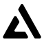

<p align="center"></p>
<h1 align="center">Aurix Net</h1>
<p align="center">
  <a href="https://github.com/aurix-voice/aurix-net/actions/workflows/ci.yml"></a>
  <a href="https://github.com/aurix-voice/aurix-net/releases"></a>
  <a href="LICENSE"></a>
</p>

Open-source, self-hosted game networking — relay rooms, server-authoritative state sync and
deterministic lockstep in one node, with matchmaking, replays and a server-side referee. One
server, one client library, three room modes; you pick per room.

Don't want to run it yourself? **[Aurix Cloud](https://aurix.run/net/)** hosts the same node: a
free tier with no card, [docs](https://aurix.run/docs/net/), tiers priced per project and never per
player. Your servers, our control plane — also possible. Aurix Net is the companion of
[Aurix Voice](https://github.com/aurix-voice/aurix); the two are separate services a game uses
independently.

* **Three room modes in one node** — `relay` (events, targets, interest groups, event cache,
  room/player props with TTL, master client, slot takeover, spectators), `sync` (server-owned
  `Frame` of entities and schema components, bit codec with deltas, owner-authoritative writes,
  area-of-interest with priority budgets, lag compensation) and `lockstep` (server clock,
  redundant input bundles, canonical journal, late join from checkpoints, desync detection with
  reference dumps, predict/rollback). Rooms move to another node when one dies; they do not die.
* **Referee** — a room's WASM simulation runs on the node itself (Wasmtime, fuel/memory/log
  budgets) and its state is the truth; the same module runs in every client.
* **Transport** — QUIC datagrams natively, WebTransport (HTTP/3) with a binary WebSocket
  fallback in browsers; reliable / unreliable / reliable-unordered channels, fragmentation,
  coalescing, per-datagram batching; JSON control channel over WebSocket and a REST API.
* **Matchmaking, lobbies, presence** — Redis-backed tickets shared across nodes, attribute and
  SQL-like filters, bot backfill, `fill_existing`; lobby statistics, friend presence, one-shot
  filtered room lists; webhooks with HMAC signatures and WebRPC calls into your backend.
* **Replays** — journals of lockstep rooms, instant-replay windows from live rooms (kill cam),
  stored replays with retention per project.
* **aurix-sim** — deterministic simulation kit in Q32.32 fixed point, identical on native and
  wasm32: 2D and 3D rigid-body physics with joints and character controllers, ray/shape casts,
  navmesh (A* + funnel, flow fields, crowd steering) and bots (behaviour trees, HFSM,
  blackboard), one flat ABI for every SDK.
* **Multi-tenant and multi-node** — projects, API keys (hashed, scoped, expiring, CIDR-bound),
  short-lived player grants with secret rotation, named operator tokens, quotas and monthly caps,
  audit log of every mutation; PostgreSQL + Redis control plane, heartbeat liveness, drain and
  handoff on `SIGTERM`, rolling upgrades, regions as a first-class field.
* **Ops** — operator console (projects, keys, quotas, rooms, nodes, desync dumps, matchmaking
  queue, usage CSV), Prometheus metrics and alert rules, backup script, distroless non-root
  image, hardened Compose, Caddy TLS example, SBOM + Trivy + `cargo deny` in CI.

> **Status: 0.1.0** — relay, sync and lockstep rooms, the referee, matchmaking, aurix-sim and the
> SDKs for Web, Unity, Rust, C/C++ and Godot; every piece is exercised by CI against a live node
> ([docs/testing.md](docs/testing.md)). Not in scope: an Unreal SDK (the engine ships its own
> netcode) and client-hosted P2P topologies.

**Documentation**: [room modes](docs/modes.md) · [API: keys, grants, REST, control channel, data
path, webhooks, matchmaking, modules](docs/api.md) · [SDK guide](docs/sdk.md) ·
[webhooks](docs/webhooks.md) · [deployment](docs/deployment.md) · [testing](docs/testing.md) ·
[aurix-sim design](docs/sim/design.md) · [release checklist](docs/release-checklist.md).

---

## Quick start

```bash
docker compose -f deploy/docker-compose.dev.yml up -d        # PostgreSQL + Redis
cargo build --release
NET__AUTH__ADMIN_TOKEN=change-me ./target/release/aurix-net-server

# create a project (the response carries its first API key)
curl -s -X POST localhost:8090/v1/operator/projects -H 'Authorization: Bearer change-me' \
     -H 'content-type: application/json' -d '{"name":"demo"}'

# load test: 100 rooms x 10 players, 20 events/s each, over QUIC
./target/release/aurix-net-loadtest --api-key an_... --rooms 100 --players 10 --rate 20
```

Config is a TOML file (`--config`); every key can be overridden as `NET__SECTION__KEY`
([config.rs](crates/net-common/src/config.rs)). Two roles run a deployment: the **operator**
(whoever hosts the nodes — quotas, drain, suspend, usage) and **projects** (API keys scoped to one
game). Self-hosting means you are both — [who does what](docs/api.md#who-does-what-operator-vs-project).

**How a client gets in**: it opens the WebSocket control channel (`/ws`), authenticates with a
grant your backend issued (`POST /v1/grants` with the project's API key) and joins a room. The node
answers with a data endpoint (host, QUIC port, certificate fingerprint, 30-second ticket); the
client connects over QUIC, sends the ticket as its first datagram, and game events travel as
datagrams from then on. Where UDP is blocked the same datagrams ride as binary WebSocket frames.

## Client SDKs

| SDK | Path | What |
|---|---|---|
| Web (TypeScript) | [`sdk/web`](sdk/web) | `@aurix/net`: relay / sync / lockstep clients, rollback runner, matchmaking, presence, instant replay, aurix-sim (wasm) |
| Unity (UPM, pure C#) | [`sdk/unity`](sdk/unity) | every platform incl. WebGL: `NetRunner` / `NetView` / `SyncBehaviour`, `NetTransform`, `NetRigidbody`, `NetAnimator`, lockstep + rollback, a host-authoritative gameplay framework (`NetworkManager`, `NetworkBehaviour`, RPCs, SyncVars, LOD, spawning) and transports for PurrNet, Mirror and FishNet over relay rooms |
| Rust | [`crates/net-client`](crates/net-client) | control + data path, rollback, replays; the reference client |
| C / C++ | [`crates/net-ffi`](crates/net-ffi), [`sdk/cpp`](sdk/cpp) | `libaurix_net` C ABI (`aurix_net.h`, `aurix_sim.h`) and a header-only C++ wrapper |
| Godot 4 (GDExtension) | [`sdk/godot`](sdk/godot) | `AurixNetClient` node over the C ABI: relay, sync and lockstep rooms, aurix-sim |

All SDKs authenticate with a short-lived grant from `POST /v1/grants`; API keys stay on your backend.
The `aurix-net` CLI ([`crates/net-cli`](crates/net-cli)) covers projects, keys, rooms, modules and
usage from a terminal; [`crates/net-loadtest`](crates/net-loadtest) drives relay / sync / lockstep bots
with loss, latency and tick reports.

## Layout

| Crate | Role |
|---|---|
| `net-common` | ids, errors, config, protocol limits |
| `net-transport` | 12-byte datagram header, channels (unreliable-sequenced, reliable-ordered, reliable-unordered) with own acks/retransmits, fragmentation, batching, QUIC endpoints (pinned certs), data tickets |
| `net-auth` | API keys (SHA-256 at rest), join grants (JWT HS256), operator token |
| `net-db` | PostgreSQL (sqlx), migrations in `migrations/` |
| `net-control` | node registry/placement, project quotas, Redis live room directory + lobby pub/sub |
| `net-rooms` | relay room logic: membership, props with CAS, events/targets/groups/cache, master, kick, offline slots |
| `net-api` | WebSocket control channel, QUIC data plane, REST + operator API, webhooks, matchmaking, metrics |
| `net-game` | server-side WASM room logic and the lockstep referee |
| `net-server` | the node binary `aurix-net-server` |
| `net-wire` | schema IDL, bit codec, quantization, deltas |
| `net-sim`, `net-sim-physics`, `net-sim-physics3d`, `net-sim-nav`, `net-sim-bots`, `net-sim-wasm` | aurix-sim: ECS frame, 2D/3D physics, navmesh, bots, the flat ABI |
| `net-replication` | per-client baselines, AOI, priority, delta build/apply |
| `net-lagcomp` | hitbox history, rewind raycasts |
| `net-fpmath` | Q32.32 fixed point, deterministic trig and RNG |
| `net-rollback` | prediction, rollback, hashes, replays |
| `net-client`, `net-ffi`, `net-cli`, `net-loadtest` | Rust client, C ABI, command line, bots |
| `dashboard/` | operator console (Vite + React), shipped as its own image |

## Security, testing and releases

| | Where | What |
|---|---|---|
| Threat model + reporting | [`SECURITY.md`](SECURITY.md) | what the node defends (tenant isolation, grant and key boundaries, bounded decoders, quotas), what it does not, how to report |
| Testing | [`docs/testing.md`](docs/testing.md) | what CI runs (fmt, clippy `-D warnings`, workspace tests, migrations on a fresh database, golden hashes native == wasm32, live Web / C# / Godot / console suites, image scans), capacity references, two-machine run, nightly soak |
| Deployment | [`docs/deployment.md`](docs/deployment.md), [`deploy/`](deploy) | network, configuration, upgrades, migrations, secrets and rotation, backups, Docker, monitoring, console |
| Releases | [`CHANGELOG.md`](CHANGELOG.md), [`docs/release-checklist.md`](docs/release-checklist.md), [`.github/workflows/release.yml`](.github/workflows/release.yml) | one SemVer number for node, console, SDKs and images (`ghcr.io/aurix-voice/aurix-net`, `aurix-net-console`), SBOM and SHA-256 sums per tag |

## License

Two licences, by what the code is for:

- **Server, AGPL-3.0-only** ([LICENSE](LICENSE)): `net-server`, `net-api`, `net-auth`, `net-control`, `net-db`, `net-rooms`, `net-game`, `net-cli`, `net-loadtest` and the `dashboard`. Run it, change it, self-host it; if you offer a modified node as a service, publish the changes.
- **Everything a game embeds, Apache-2.0** ([LICENSE-APACHE](LICENSE-APACHE)): `net-client`, `net-common`, `net-wire`, `net-transport`, `net-ffi`, `net-replication`, `net-rollback`, `net-lagcomp`, `net-fpmath`, all `net-sim*` crates and every SDK under `sdk/` (Web, Unity, Godot, C/C++). Ship them in closed-source games without obligations beyond attribution.

Each crate states its licence in `Cargo.toml`; each SDK package in its `package.json`.
